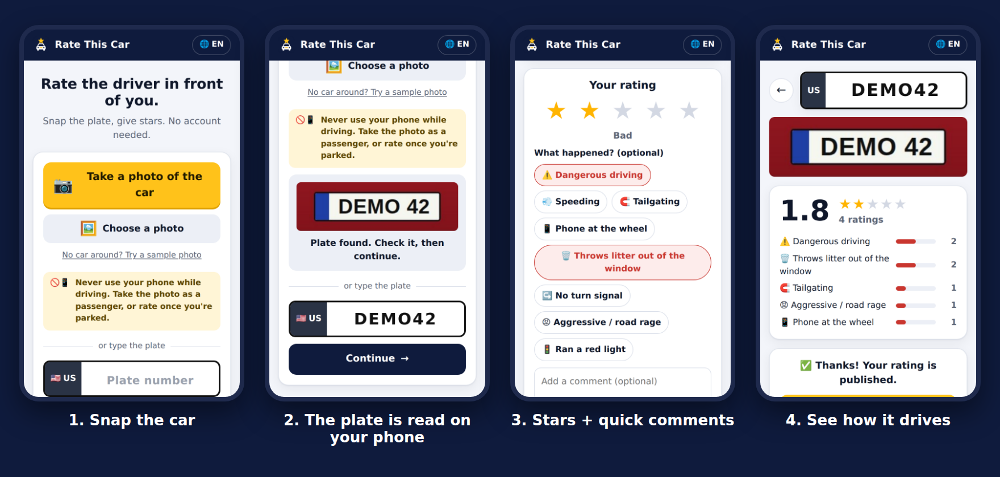

# Rate This Car 🚗⭐

**Rate the driver in front of you.** Snap the plate, give stars. No account needed.



- **Just a URL.** Works in any mobile browser and installs to the home screen (PWA). No app store.
- **Reads the plate on the phone.** A plate detector and a plate reader run in WebAssembly. The photo is never uploaded.
- **Very simple.** 1 to 5 stars, one-tap quick comments ("dangerous driving", "throws litter out of the window", "courteous"…) and an optional short comment.
- **5 languages**, picked automatically: English, 中文, हिन्दी (the three most spoken), plus Español and Français.
- **Privacy by design.**
  - Plates are stored as keyed hashes, never in clear.
  - No accounts, no location, no photos.
  - The anti-abuse hashes of IP address and device are wiped after 48 h.
  - Ratings are deleted after 12 months.
  - Abusive ratings can be reported and are hidden after 3 reports.
- **Free to host** on Cloudflare Workers + D1.

## Deploy (free, about 2 minutes)

[](https://deploy.workers.cloudflare.com/?url=https://github.com/GraphaelIviglia/projects/tree/rate-this-car/rate-this-car)

The button:
1. copies this folder to a new repository in your GitHub account;
2. creates the database;
3. deploys the app to `https://rate-this-car.<your-subdomain>.workers.dev`.

Pushes to that repository then redeploy automatically. If this folder moves to another branch, update the `tree/<branch>` part of the button link.

Or deploy from the command line:

```sh
cd rate-this-car
npm install
npx wrangler login   # opens the browser once
npm run deploy
```

There is nothing else to set up. The D1 database is created on the first deploy, and the Worker creates its tables on the first request.

### After deploying

- **Contact for removal requests.** Put your email in `CONTACT_EMAIL` in `wrangler.jsonc`, then redeploy. It is shown on the "About & privacy" page.
- **Moderation.** Run `npx wrangler secret put ADMIN_TOKEN` and pick a long random value. This enables the [moderation API](#moderation).
- **Custom domain (optional).** Cloudflare dashboard → Workers & Pages → rate-this-car → Settings → Domains & Routes.

## Local development

```sh
npm install
npm run dev     # http://localhost:8787 with a local database
npm test        # unit tests + API tests against a local Worker
```

On a computer without a car in front of you, use **"No car around? Try a sample photo"**. It loads a demo car with the fictional plate `DEMO 42`.

## How it works

```
Phone (PWA, static files)                          Cloudflare Worker          D1 (SQLite)
 photo ─► YOLOv9 plate detector ─► plate OCR ─► ┐
          (onnxruntime-web, on device)          ├─► /api/ratings ─────────► ratings (plate_key = HMAC)
 typed plate ───────────────────────────────────┘   /api/plates/:cc/:plate ◄─ average, tags, recent
```

- **Front end** (`public/`): plain HTML, CSS and JavaScript modules, with no build step.
  - `js/plate-reader.js` runs the models.
  - `js/shared.js` holds plate normalization, tags and validation. The API reuses it.
  - `js/i18n.js` holds the translations.
  - `sw.js` provides offline support and caches the models after the first use.
- **API** (`src/worker.js`): a Cloudflare Worker with a D1 database.
  - The schema is created on first use.
  - A daily cron wipes anti-abuse hashes and applies the retention period.
  - Endpoints:
    - `GET /api/plates/:country/:plate`: summary and recent ratings.
    - `POST /api/ratings`: add a rating.
    - `POST /api/ratings/:id/report`: report a rating.
    - `GET /api/info`: counters and settings.
- **Abuse limits.** Each device can rate the same car once a day and at most 30 cars a day. A few people behind the same IP (mobile networks) can rate the same car; beyond that the IP is blocked for that car, with at most 100 ratings per IP per day. Cross-site writes are refused, and comments with links, emails or phone numbers are rejected.

### Plate reader accuracy

Exact full-plate match, measured on the [OpenALPR end-to-end benchmark](https://github.com/openalpr/benchmarks) with the models shipped here:

| Set | Photos | Plate found | Exact read |
|---|---|---|---|
| Europe | 108 | 100% | 93.5% |
| United States | 222 | 99.5% | 88.3% |
| Brazil | 114 | 100% | 99.1% |
| **All** | **444** | **99.8%** | **92.3%** |

Some of the "misses" are ambiguous 0/O in the ground truth. The user always checks and can edit the plate before rating.

The runtime and models are downloaded once (about 13 MB compressed), in the background while the user takes the photo, then served from cache. Reading a photo takes 0.1–0.5 s on a laptop; expect a little more on phones.

Known limit: the OCR model reads Latin letters and digits. Chinese province characters (e.g. 京) have to be typed. Plates from countries the model was not trained on (such as India and China) are flagged "please check".

## Moderation

With `ADMIN_TOKEN` set (`A=$ADMIN_TOKEN`, `APP=https://your-app`):

```sh
# Reported ratings, most reported first
curl -H "Authorization: Bearer $A" $APP/api/admin/reported
# Delete one rating
curl -X DELETE -H "Authorization: Bearer $A" $APP/api/admin/ratings/123
# Delete every rating of a plate (e.g. after a removal request)
curl -X DELETE -H "Authorization: Bearer $A" $APP/api/admin/plates/FR/AB123CD
# Un-hide a rating hidden by reports
curl -X POST -H "Authorization: Bearer $A" $APP/api/admin/ratings/123/restore
```

## Privacy and legal notes

The app stores:
- per rating: stars, tag ids, the optional comment, the UI language, a timestamp and a keyed hash of `country + plate`;
- for 48 hours only: daily-rotating keyed hashes of the IP address and of a random device id, used for abuse limits;
- for 30 days: a keyed hash of the IP of each reporter.

The hashing secret is generated randomly inside each deployment's database.

⚠️ **Licence plates are personal data under the GDPR.** Publishing ratings linked to plates carries real legal risk in the EU:
- German courts upheld a ban on public plate ratings (fahrerbewertung.de: VG Köln 2017, OVG NRW 16 A 770/17).
- The French data-protection authority (CNIL) advises against publishing plates to denounce drivers.
- Defamation law also applies.

Get legal advice before a public launch. See [`LAUNCH.md`](LAUNCH.md).

## Updating the plate reader

- `npm run vendor` copies the onnxruntime-web runtime into `public/vendor/ort/`. The version is pinned in `package.json`.
- If you change files in `public/models/` or `public/vendor/`, bump `VERSION` in `public/sw.js` so phones fetch the new files.

## Credits and licences

- App code: MIT (see `LICENSE`).
- Plate detector: `yolo-v9-t-384-license-plates-end2end` from [open-image-models](https://github.com/ankandrew/open-image-models) (MIT).
- Plate OCR: `cct-s-v2-global-model` from [fast-plate-ocr](https://github.com/ankandrew/fast-plate-ocr) (MIT), int8-quantized for size.
- Runtime: [onnxruntime-web](https://github.com/microsoft/onnxruntime) (MIT).

See [`THIRD_PARTY_NOTICES.md`](THIRD_PARTY_NOTICES.md).
